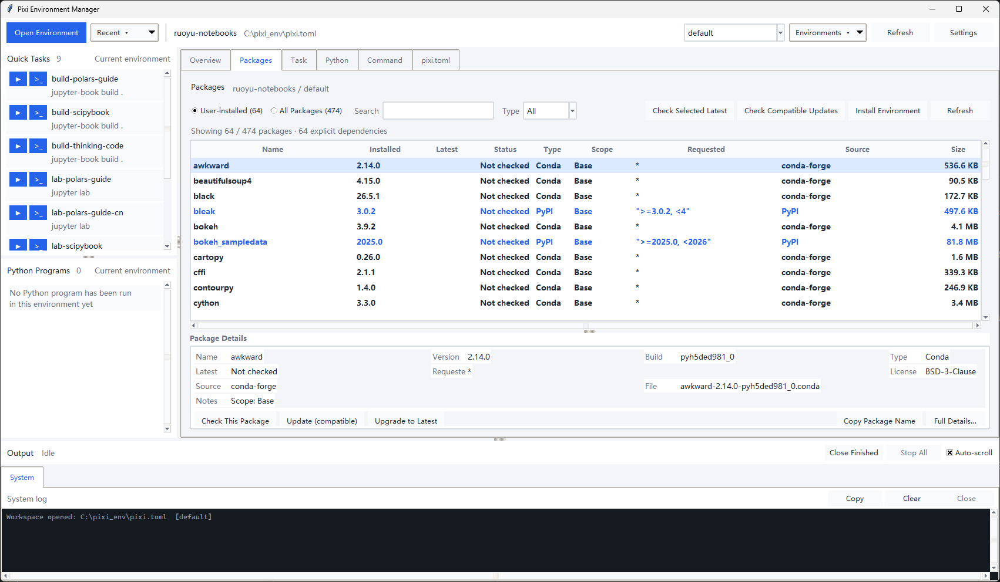
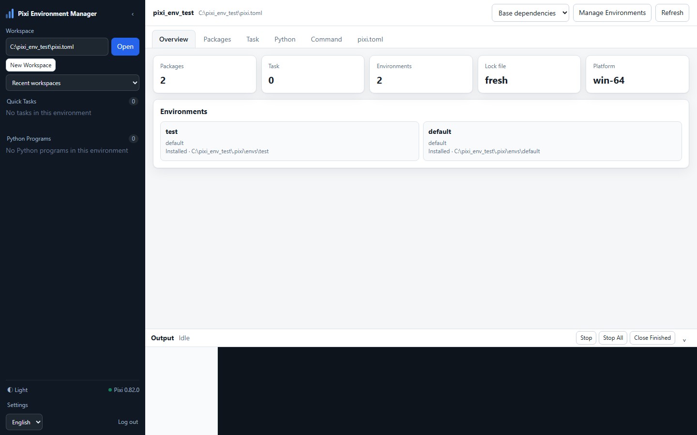

# Pixi Environment Manager



[中文](#中文) · [English](#english) · [日本語](#日本語)

---

# 中文

一个用 **Python 标准库 + Tkinter** 编写的 Pixi 工作区管理 GUI。无需安装第三方
Python 包，任何带有 Tk 8.6 的 Python 3.9+ 环境都可以直接运行。

## 功能

- **打开 Pixi 环境**：选择 `pixi.toml`、`pyproject.toml` 或工作区目录。
- **最近打开**：顶部环境管理条记录工作区 + 环境名，下次启动自动恢复最近环境。
- **环境切换**：识别工作区中的所有命名环境，在顶部下拉框切换。
- **新建工作区**：可以从空目录直接创建新的 `pixi.toml` 工作区；支持指定频道和平台，
  创建后自动进入基础依赖视图。
- **基础依赖视图**：顶部还可以选择“基础依赖”（default feature），只列出
  `[dependencies]` / `[pypi-dependencies]` 中的共享依赖；默认环境视图则显示完整环境，
  并在“作用域”列标出基础、feature、环境专属和传递依赖。
- **环境管理**：顶部“环境管理”菜单可以添加/删除命名环境；添加时可选择 features、
  solve group，并默认勾选安装；删除时可选择同时清理 `.pixi` 环境目录。
- **库列表**：
  - 仅用户安装（`is_explicit = true` 的显式依赖）
  - 全部已安装包（含传递依赖）
  - 按名称搜索、按类型过滤、按列排序
  - 显示已安装版本、最新版本、更新状态、请求约束、来源、大小
  - 详情面板显示关键字段；“完整详情”对话框显示依赖、约束、URL 等全部信息
- **版本检查**：
  - 选中包后查询 conda / PyPI 最新版本
  - conda 查询同时合并所选平台与 `noarch` 记录，避免纯 Python 包误报旧版本
  - 一键检查当前版本约束内的兼容更新（`pixi update --dry-run --json`，不修改文件）
  - 右键可更新到兼容版本或升级到最新版本
- **`pixi.toml` 编辑器**：
  - 行号、当前行高亮、TOML 语法高亮（自实现，零依赖）
  - 保存、撤销/重做、查找、重新加载
  - 未保存提示、外部修改检测、原子写入
  - 保存后用 `tomllib` 检查语法；刷新工作区信息
- **Task 快速启动**：
  - 左侧“快速任务”列表，一键启动
  - 带参数启动、在独立终端运行
  - 完整 Task 页面显示命令、目录、feature、依赖
- **Python 程序运行**：
  - 文件对话框选择或直接输入绝对路径
  - 在选中 Pixi 环境中运行
  - 支持参数和工作目录
  - 左侧按“工作区 + 环境”记录最近运行的程序和参数，一键重复运行
- **命令中心**：
  - `add`、`remove`、`update`、`upgrade`、`search`、`install`、`lock`、
    `clean`、`reinstall`、`run`、`task add`、`task remove`、`info`、`shell`、`init`
  - 每个命令有说明、参数表单、实时命令预览和完整 `--help`
  - 手动命令输入栏
- **多任务输出**：
  - Task 和 Python 程序可以同时运行多个
  - 下方每个任务一个输出标签页，各自带停止、复制、清空、关闭按钮
  - 完成/失败/停止的标签页保留，手动关闭或“关闭已完成”
  - 会修改环境/清单的 pixi 命令同一时间只允许运行一个
- **主题**：浅色 / 深色切换。
- **语言**：中文 / English / 日本語，在设置中切换，重启后生效。
- **Web UI**：可选的 Flask 界面，支持局域网访问、单密码登录、包管理、任务输出和编辑器。
- **历史与设置**：保存在 `%APPDATA%\PixiEnvManager\state.json`。

## 运行

### 双击启动

双击项目根目录的 `start.bat`。

启动脚本会依次尝试：

1. 环境变量 `PIXI_ENV_MANAGER_PYTHON` 指定的 `pythonw.exe`
2. 本机默认 Pixi 环境 `C:\pixi_env\.pixi\envs\default\pythonw.exe`
3. `%LOCALAPPDATA%\Programs\Python\Python3*\pythonw.exe`
4. `C:\Python3*\pythonw.exe`
5. PATH 上的 `pythonw`

如果都没有，会提示安装 Python 或设置环境变量。启动脚本会先验证候选解释器
能导入 Tkinter，避免 Windows Python Launcher 指向失效环境时静默失败。

### 命令行启动

```powershell
py -3 .\pixi_env_manager.py
# 或者直接打开某个工作区
py -3 .\pixi_env_manager.py C:\pixi_env\pixi.toml
```

也可以使用任意 Python 3.9+：

```powershell
C:\some\python.exe .\pixi_env_manager.py
```

### Web 界面



默认启动 Tk 界面；加 `--web` 启动 Flask Web UI：

首次使用 Web 模式需要 Flask：

```powershell
pip install -r requirements.txt
```

```powershell
# 首次设置密码（本地终端隐藏输入）
start.bat --web --set-password

# 只允许本机访问
start.bat --web --host 127.0.0.1 --port 8010

# 允许局域网访问
start.bat --web --host 0.0.0.0 --port 8010
```

浏览器打开 `http://本机IP:8010`，使用设置的密码登录。所有 Web 访问（包括
localhost）都需要登录。

- 默认只绑定 `127.0.0.1`；`--host 0.0.0.0` 才开放局域网
- 首版使用 HTTP，不加密；只建议在可信局域网使用
- 没有设置密码时 Web 服务拒绝启动
- Web 和 Tk 共用 `PixiClient`、`JobManager`、`app/state.py` 以及 `locales/*.json`
- Web 的“在终端中运行”会在运行服务器的电脑上打开本地终端
- Web 使用 Flask；Tk 模式仍然只依赖标准库
- 密码以 PBKDF2-SHA256 哈希保存，默认会话 7 天
- 登录有 CSRF 防护和失败次数限速
- 忘记密码时在服务器本机重新执行 `start.bat --web --set-password`
- 首版不提供 Web 修改密码；密码和会话可能被局域网嗅探，因此只建议可信网络

### 多台电脑

每台需要管理的电脑分别启动自己的 Web 服务：

```text
电脑 A: start.bat --web --host 0.0.0.0 --port 8010
电脑 B: start.bat --web --host 0.0.0.0 --port 8010
```

浏览器分别访问 `http://电脑A-IP:8010`、`http://电脑B-IP:8010`。没有中心服务器，
也没有跨机器远程执行；每个 Web 服务只管理该电脑本地的 Pixi 环境。

## 使用说明

### 顶部环境管理条

- `打开环境`：
  - 选择已有 `pixi.toml` / `pyproject.toml` 或工作区目录直接打开
  - 选择没有清单的空目录或输入不存在的目录时，会提示创建新 Pixi 工作区
  - `新建工作区…` 按钮可以直接打开创建向导
  - 新建向导只创建 `pixi.toml`，支持多个频道和平台；工作区名称由目录名决定
  - 创建过程在输出标签页中显示，成功后自动打开并进入基础依赖视图
- `最近打开`：历史工作区 + 环境，点击直接切换。
- 当前工作区名称 / 路径：点击路径可复制。
- `环境` 下拉框：切换命名环境；切换后左侧任务和 Python 历史会同步过滤。
  - `基础依赖`：只显示共享的基础依赖，`add` / `remove` 不带 `--environment`，
    作用于所有环境；Task/Python 仍使用 default 环境运行。
  - `default` / `test`：显示该环境的完整库列表；`add` / `remove` 带
    `--environment`，只影响该环境。default 视图下添加的是
    `[environments.default.dependencies]` 专属依赖，其他环境看不到；要添加共享依赖
    请切换到“基础依赖”。
  - 基础依赖模式按工作区持久化，重新打开同一工作区时恢复。
- `环境管理` 菜单：
  - `添加环境…`：输入名称、选择 features、可选 solve group；默认勾选“创建后立即安装”
  - `删除当前环境…`：`default` 不能删除；可选同时清理已安装的 `.pixi` 环境目录
  - 添加/删除都会保留 `pixi.toml` 原有注释；删除只移除清单定义，不自动改 lock
- `刷新`：重新读取环境、包列表和 task。
- `设置`：Pixi 路径、终端程序、界面语言、主题、控制台最大行数、清空历史。
  - 终端留空时使用 PowerShell
  - 可填 `powershell.exe`、`pwsh.exe`、`cmd.exe`、`wt.exe` 或完整路径
  - 也支持模板，例如 `wt.exe -d "{cwd}" powershell.exe -NoExit -Command {command}`

### 左侧快速启动

- **快速任务**：当前环境的 task，点击 `▶` 在输出栏运行，点击 `>_` 在独立终端运行；
  右键可带参数或在终端运行。
- **Python 程序**：只显示用当前工作区 + 当前环境运行过的脚本。点击 `▶` 用保存的
  参数在输出栏运行，点击 `>_` 在独立终端运行；单击条目会把脚本、参数、工作目录
  加载到 Python 页，方便修改。

每个“环境 + 脚本路径”保留最近一次参数。修改参数后再次运行会覆盖保存的参数。

### 库列表

“仅用户安装”是清单中显式声明的 conda / PyPI 依赖，不是所有曾经安装过的包。
传递依赖只在“全部库”中显示。

“检查兼容更新”不会修改任何文件。单包“查询最新版本”会：

- conda 包：调用 `pixi search <包名> --json`，合并当前平台和 `noarch` 的结果
- PyPI 包：访问 `https://pypi.org/pypi/<包名>/json`

如果 PyPI 包来自自定义索引，GUI 会提示无法通过公共 API 检查，而不会伪造结果。

### 多任务与输出

Task 和 Python 程序可以连续启动多个，不会因为已有任务运行而被阻塞。底部输出区
会为每个任务创建独立标签页：

- 每个标签页有自己的“停止”按钮，只终止该任务及其子进程树
- 任务完成后，标签页保留输出，可手动关闭
- “全部停止”用于一次性停止所有 GUI 任务
- 修改环境/清单的 pixi 命令（add、install、update、clean 等）会串行执行，避免
  同时写 lock 文件或环境目录

### 界面语言

在“设置 → 界面语言”中选择中文、English 或 日本語，保存后重启程序生效。
界面源码使用英文，`locales/zh.json` 和 `locales/ja.json` 以英文为 key 保存翻译；
直接编辑 JSON 即可修改文案。Pixi 自身的 `--help` 和命令输出保持原语言；少量较不
常用的提示在日文模式下会回退为英文。

### 布局与快捷键

- 侧面栏和下方输出栏的宽高会在关闭时保存，下次启动恢复。
- `Ctrl+B` 折叠/展开侧面栏。
- `Ctrl+J` 折叠/展开下方输出栏。
- 折叠状态也会保存；再次展开时恢复折叠前的尺寸。

### 编辑器

- `Ctrl+S` 保存，`Ctrl+F` 查找，`Ctrl+R` 重新加载。
- 保存前会用标准库 `tomllib` 检查语法（Python 3.11+）。有语法错误时会询问是否
  仍然保存，避免打断编辑。
- 保存采用临时文件 + `os.replace` 的原子写入方式。
- 同一文件被外部程序修改时，保存前会提示覆盖风险。

### 命令中心

表单只覆盖常用参数；高级参数可以使用下方的手动命令，或者参考右侧完整 `--help`。

手动命令：

- 输入 `add numpy` 或完整 `pixi add numpy`
- 自动附加当前工作区的 `--manifest-path`（可取消勾选）
- 按参数直接执行，不经过 shell；管道/重定向请使用独立终端

## 环境要求

- Windows 10/11
- Python 3.9+（需要 Tkinter；Windows 官方安装包默认包含）
- Pixi 0.82+（其他较新版本通常也可以；JSON 字段变化时会给出错误提示）
- Tk 模式不需要 `pip install` 任何包；Web 模式需要 Flask 3.x

## 测试

```powershell
C:\pixi_env\.pixi\envs\default\python.exe -m unittest discover -s tests -v
```

测试覆盖版本比较、状态持久化、TOML 高亮、Pixi JSON 解析（含 noarch 合并）、
Windows 参数拆分、国际化模板和多任务命令分类。GUI 本身使用标准 Tkinter，
不做无显示器的单元测试。

## 项目结构

```
pixi-env-manager/
  pixi_env_manager.py      入口
  start.bat                双击启动
  locales/
    zh.json                中文翻译（英文 key）
    ja.json                日文翻译（英文 key）
  app/
    state.py                设置、环境历史、Python 运行历史
    i18n.py                 翻译控制器（英文源码 + JSON 词典）
    pixi.py                 Pixi CLI 封装
    models.py               数据模型
    manifest.py             基础/feature/环境依赖作用域解析
    workspace_init.py       新建工作区命令构建
    jobs.py                 后台命令、输出流、停止进程树
    versions.py             版本比较
    toml_highlight.py       TOML 词法高亮
    util.py                 参数拆分、路径显示等
    ui/
      main_window.py        主窗口和集成逻辑
      sidebar.py            左侧快速任务/Python 历史
      overview_tab.py
      libraries_tab.py
      tasks_tab.py
      python_tab.py
      commands_tab.py
      editor_tab.py
      console_panel.py
      dialogs.py
      theme.py
      widgets.py
    web/                    Flask Web UI (auth / service / server / templates / static)
  tests/
```

## 已知限制

- 版本比较实现了常见 PEP 440 / conda 规则，但极端版本字符串可能只能做自然排序。
  此时界面仍会显示原始最新版本，不会隐藏数据。
- 只有 `pypi.org` 的 PyPI 包能自动查最新版本；私有索引会提示不支持。
- 交互式 task（例如 Jupyter Lab）建议使用“在终端中运行”，GUI 控制台适合构建类任务。
- 关闭窗口会终止 GUI 启动的子进程树；在独立终端中启动的程序不受影响。
- 切换界面语言需要重启程序；正在运行的输出标签不会跨重启保留。
- 日文界面中少量不常用提示会回退英文，Pixi CLI 原始输出不翻译。
- 删除环境时“同时清理目录”会先执行 `pixi clean`，再删除清单定义；如果后续删除
  定义失败，目录可能已经被清理。添加/删除环境不会自动更新 lock，之后请按提示
  lock/install。
- 基础依赖模式只显示 `[dependencies]` / `[pypi-dependencies]` 中直接声明的包，
  不显示传递依赖；要看完整 default 环境请切换到 default。
- 删除基础依赖会提示“所有环境受影响”；从 default/test 视图删除基础依赖时，
  GUI 会改为不带 `--environment` 的基础依赖删除命令。
- 命令中心的 Environment 选项与顶部选择同步；在基础依赖模式下，add/remove
  的 Environment 固定为“不指定”，其他命令仍使用 default。
- 新建工作区只支持 `pixi.toml`。已有 `pyproject.toml` 的目录不会用新建向导覆盖；
  已有 Pixi 清单时请直接打开。
- `pixi init` 会追加 `.gitignore`、`.gitattributes` 和 `pixi.toml`，不会删除目录中
  已有文件；非空目录会先提示确认。

---

# English

A Pixi workspace management GUI built with the **Python standard library + Tkinter**.
No third-party Python packages are required; it runs on any Python 3.9+ installation
with Tk 8.6.

## Features

- **Open a Pixi environment**: choose a `pixi.toml`, a `pyproject.toml`, or a workspace directory.
- **Recent**: the top bar records the workspace + environment and restores the last one on startup.
- **Environment switching**: discovers every named environment in the workspace and switches via the top dropdown.
- **New workspace**: create a new `pixi.toml` workspace from an empty directory, with selectable channels and platforms. The new workspace opens in the Base dependencies view.
- **Base dependencies view**: choose **Base dependencies** (the default feature) at the top to list only shared dependencies from `[dependencies]` / `[pypi-dependencies]`. The environment view shows the full environment and marks each package as base, feature, environment-only, or transitive in the **Scope** column.
- **Environment management**: add or delete named environments from the top **Environments** menu. Creating an environment supports features and an optional solve group and installs it by default. Deleting can optionally clean the `.pixi` environment directory.
- **Package list**:
  - User-installed packages (explicit dependencies where `is_explicit = true`)
  - All installed packages, including transitive dependencies
  - Search by name, filter by kind, and sort by column
  - Show installed version, latest version, update status, requested constraint, source, and size
  - The details panel shows key fields; **Full details** shows dependencies, constraints, URL, and more
- **Version checks**:
  - Query the latest conda / PyPI version for selected packages
  - conda queries merge the selected platform and `noarch` records so pure-Python packages are not reported as outdated
  - Check compatible updates within the current constraints with one click (`pixi update --dry-run --json`, no files changed)
  - Right-click to update to a compatible version or upgrade to the latest version
- **`pixi.toml` editor**:
  - Line numbers, current-line highlight, and TOML syntax highlighting (custom, zero dependencies)
  - Save, undo/redo, find, and reload
  - Unsaved-change prompts, external-modification detection, and atomic writes
  - Validate syntax with `tomllib` after saving and refresh the workspace
- **Task quick start**:
  - **Quick Tasks** list in the sidebar, one-click launch
  - Launch with arguments or in a separate terminal
  - The full Task page shows command, directory, feature, and dependencies
- **Python programs**:
  - Choose a script with a file dialog or enter an absolute path
  - Run it in the selected Pixi environment
  - Support arguments and a working directory
  - Keep recent scripts and arguments per workspace + environment in the sidebar for one-click reruns
- **Command Center**:
  - `add`, `remove`, `update`, `upgrade`, `search`, `install`, `lock`, `clean`, `reinstall`, `run`, `task add`, `task remove`, `info`, `shell`, and `init`
  - Each command has a description, argument form, live command preview, and full `--help`
  - Manual command input
- **Concurrent output**:
  - Multiple Tasks and Python programs can run at the same time
  - Each job gets its own output tab with stop, copy, clear, and close buttons
  - Completed, failed, and stopped tabs remain until closed manually or via **Close finished**
  - Environment- or manifest-mutating pixi commands run one at a time
- **Theme**: light / dark.
- **Languages**: Chinese / English / Japanese, switched in Settings and applied after restart.
- **Web UI**: optional Flask interface with LAN access, single-password login, package management, job output, and the editor.
- **History and settings**: stored in `%APPDATA%\PixiEnvManager\state.json`.

## Running

### Double-click

Double-click `start.bat` in the project root.

The launcher tries, in order:

1. The `pythonw.exe` specified by `PIXI_ENV_MANAGER_PYTHON`
2. The local default Pixi environment `C:\pixi_env\.pixi\envs\default\pythonw.exe`
3. `%LOCALAPPDATA%\Programs\Python\Python3*\pythonw.exe`
4. `C:\Python3*\pythonw.exe`
5. `pythonw` from `PATH`

If none is found, it asks you to install Python or set the environment variable. The
launcher first verifies that the candidate interpreter can import Tkinter, avoiding
silent failures when the Windows Python Launcher points to a broken environment.

### Command line

```powershell
py -3 .\pixi_env_manager.py
# Or open a workspace directly
py -3 .\pixi_env_manager.py C:\pixi_env\pixi.toml
```

Any Python 3.9+ interpreter can also be used:

```powershell
C:\some\python.exe .\pixi_env_manager.py
```

### Web UI


The default entry point starts Tk; add `--web` for the Flask Web UI:

Install Flask once for Web mode:

```powershell
pip install -r requirements.txt
```

```powershell
# Set the password once (hidden local input)
start.bat --web --set-password

# Local-only access
start.bat --web --host 127.0.0.1 --port 8010

# LAN access
start.bat --web --host 0.0.0.0 --port 8010
```

Open `http://this-computer-ip:8010` and sign in with that password. Every Web
request, including localhost, requires authentication.

- Defaults to `127.0.0.1`; only `--host 0.0.0.0` exposes the LAN interface
- The first version uses HTTP without TLS; use only on a trusted LAN
- The Web server refuses to start if no password is configured
- Tk and Web share `PixiClient`, `JobManager`, `app/state.py`, and `locales/*.json`
- **Run in Terminal** opens a terminal on the computer running the Web server
- The Web UI uses Flask; Tk mode remains standard-library only
- Passwords are stored as PBKDF2-SHA256 hashes; sessions last 7 days by default
- Login uses CSRF protection and failed-attempt rate limiting
- Reset a forgotten password locally with `start.bat --web --set-password`
- Password changes via the Web UI are not supported in the first version; HTTP traffic can be sniffed on a LAN

### Multiple computers

Run a separate Web server on each computer to manage:

```text
PC A: start.bat --web --host 0.0.0.0 --port 8010
PC B: start.bat --web --host 0.0.0.0 --port 8010
```

Open `http://pc-a-ip:8010` and `http://pc-b-ip:8010`. There is no central hub
and no cross-machine execution; each server manages its own local Pixi workspace.

## Usage

### Top environment bar

- **Open environment**:
  - Open an existing `pixi.toml` / `pyproject.toml` or a workspace directory
  - Selecting an empty directory or entering a non-existent directory offers to create a new Pixi workspace
  - The **New workspace…** button opens the creation wizard directly
  - The wizard creates only `pixi.toml`; multiple channels and platforms are supported, and the workspace name comes from the directory name
  - Creation progress appears in an output tab; on success the workspace opens in the Base dependencies view
- **Recent**: previous workspaces + environments; click to switch.
- **Workspace name / path**: click the path to copy it.
- **Environment dropdown**: switch named environments; the sidebar Task and Python history filter accordingly.
  - **Base dependencies**: shows only shared base dependencies. `add` / `remove` omit `--environment` and affect every environment. Task/Python still run in the default environment.
  - **default** / **test**: show that environment's full package list. `add` / `remove` pass `--environment` and affect only that environment. In the default view, additions go to `[environments.default.dependencies]` and are invisible to other environments; switch to **Base dependencies** to add shared dependencies.
  - Base mode is persisted per workspace and restored when the same workspace is reopened.
- **Environments** menu:
  - **Add environment…**: enter a name, select features, and optionally a solve group; **Install after creation** is checked by default
  - **Delete current environment…**: `default` cannot be deleted; optionally clean the installed `.pixi` environment directory
  - Add/delete preserves existing `pixi.toml` comments; deletion only removes the manifest definition and does not update the lock file
- **Refresh**: re-read environments, package lists, and tasks.
- **Settings**: Pixi path, terminal program, UI language, theme, maximum console lines, and history cleanup.
  - An empty terminal setting uses PowerShell
  - You can enter `powershell.exe`, `pwsh.exe`, `cmd.exe`, `wt.exe`, or a full path
  - Templates are supported, for example `wt.exe -d "{cwd}" powershell.exe -NoExit -Command {command}`

### Sidebar quick launch

- **Quick Tasks**: tasks in the current environment. Click `▶` to run in the output panel, or `>_` to run in a separate terminal. Right-click for arguments or terminal launch.
- **Python programs**: scripts previously run with the current workspace + environment. Click `▶` to run with saved arguments in the output panel, or `>_` to run in a separate terminal. Clicking a row loads the script, arguments, and working directory into the Python tab for editing.

The most recent arguments are kept for each environment + script path. Running again after editing the arguments replaces the saved values.

### Package list

**User-installed** means explicit conda / PyPI dependencies declared in the manifest, not every package ever installed. Transitive dependencies appear only under **All packages**.

**Check compatible updates** does not modify files. **Query latest version** for a package:

- conda packages: calls `pixi search <package> --json` and merges the current platform and `noarch` results
- PyPI packages: requests `https://pypi.org/pypi/<package>/json`

If a PyPI package comes from a custom index, the GUI reports that the public API cannot
check it rather than inventing a result.

### Concurrent jobs and output

Tasks and Python programs can be launched repeatedly without being blocked by running
jobs. The output area at the bottom creates a separate tab for each job:

- Each tab has its own **Stop** button that terminates only that job and its process tree
- Completed tabs keep their output and can be closed manually
- **Stop all** stops every GUI job at once
- Environment- or manifest-mutating pixi commands (`add`, `install`, `update`, `clean`, etc.) run serially to avoid concurrent lock-file or environment-directory writes

### UI language

Choose Chinese, English, or Japanese under **Settings → UI language**; restart the
application to apply it. UI source strings are English, and `locales/zh.json` /
`locales/ja.json` store translations keyed by those English strings. Edit the JSON
files directly to change wording. Pixi's own `--help` and command output keep their
original language. A few less common prompts fall back to English in Japanese mode.

### Layout and shortcuts

- Sidebar width and output-panel height are saved on exit and restored on the next start.
- `Ctrl+B` collapses/expands the sidebar.
- `Ctrl+J` collapses/expands the output panel.
- Collapsed state is saved too; expanding restores the previous size.

### Editor

- `Ctrl+S` saves, `Ctrl+F` finds, and `Ctrl+R` reloads.
- Before saving, the editor validates syntax with the standard-library `tomllib` (Python 3.11+). If there is a syntax error, it asks whether to save anyway so editing is not interrupted.
- Saves use a temporary file plus atomic `os.replace`.
- If the same file was modified externally, saving warns about the overwrite risk.

### Command Center

Forms cover common arguments. For advanced options, use the manual command below or
the full `--help` on the right.

Manual command:

- Enter `add numpy` or the full `pixi add numpy`
- The current workspace's `--manifest-path` is appended automatically (can be disabled)
- Arguments are executed directly, without a shell; use a separate terminal for pipes/redirection

## Requirements

- Windows 10/11
- Python 3.9+ (Tkinter required; included in the official Windows installer)
- Pixi 0.82+ (newer versions usually work; JSON field changes produce an error message)
- Tk mode requires no `pip install` packages; Web mode requires Flask 3.x

## Tests

```powershell
C:\pixi_env\.pixi\envs\default\python.exe -m unittest discover -s tests -v
```

Tests cover version comparison, state persistence, TOML highlighting, Pixi JSON parsing
(including noarch merging), Windows argument splitting, i18n templates, and job-mutation
classification. The GUI itself uses standard Tkinter and is not covered by headless
unit tests.

## Project structure

```
pixi-env-manager/
  pixi_env_manager.py      Entry point
  start.bat                Double-click launcher
  locales/
    zh.json                Chinese translations (English keys)
    ja.json                Japanese translations (English keys)
  app/
    state.py               Settings, environment history, Python run history
    i18n.py                Translation controller (English source + JSON catalogs)
    pixi.py                Pixi CLI wrapper
    models.py              Data models
    manifest.py            Base/feature/environment dependency scope parsing
    workspace_init.py      New-workspace command helpers
    jobs.py                Background commands, output streaming, process-tree stop
    versions.py            Version comparison
    toml_highlight.py      TOML lexical highlighting
    util.py                Argument splitting, path display, etc.
    ui/
      main_window.py       Main window and integration
      sidebar.py           Quick Tasks / Python history sidebar
      overview_tab.py
      libraries_tab.py
      tasks_tab.py
      python_tab.py
      commands_tab.py
      editor_tab.py
      console_panel.py
      dialogs.py
      theme.py
      widgets.py
    web/                    Flask Web UI (auth / service / server / templates / static)
  tests/
```

## Known limitations

- Version comparison implements common PEP 440 / conda rules, but extreme version strings may fall back to natural sorting. The UI still shows the raw latest version and never hides data.
- Only PyPI packages on `pypi.org` can be checked automatically; private indexes are reported as unsupported.
- Interactive tasks (such as Jupyter Lab) are best launched with **Run in Terminal**; the GUI console is intended for build-style tasks.
- Closing the window terminates child process trees started by the GUI; programs launched in separate terminals are unaffected.
- Changing the UI language requires a restart; running output tabs do not survive a restart.
- A few uncommon Japanese UI prompts fall back to English; raw Pixi CLI output is not translated.
- When deleting an environment with **clean directory** enabled, `pixi clean` runs before the manifest definition is removed. If the subsequent removal fails, the directory may already have been cleaned. Adding/deleting environments does not update the lock file automatically; follow the prompts to lock/install.
- Base dependencies mode lists only packages declared directly in `[dependencies]` / `[pypi-dependencies]` and hides transitive dependencies; switch to default to see the full environment.
- Deleting a base dependency warns that all environments are affected. When deleting a base dependency from the default/test view, the GUI switches to a base-dependency removal command without `--environment`.
- Command Center's Environment option follows the top selection. In Base dependencies mode, add/remove is fixed to **not specified**; other commands still use default.
- New workspaces support only `pixi.toml`. A directory that already contains `pyproject.toml` is not overwritten by the wizard; open an existing Pixi manifest directly.
- `pixi init` appends `.gitignore`, `.gitattributes`, and `pixi.toml` without deleting existing files; non-empty directories require confirmation.

---

# 日本語

**Python 標準ライブラリ + Tkinter** で作られた Pixi ワークスペース管理 GUI です。
サードパーティ製 Python パッケージは不要で、Tk 8.6 が入った Python 3.9+ 環境で
そのまま動作します。

## 機能

- **Pixi 環境を開く**：`pixi.toml`、`pyproject.toml`、またはワークスペースディレクトリを選択します。
- **最近開いた**：上部の環境バーがワークスペース + 環境名を記録し、次回起動時に最後の環境を復元します。
- **環境の切り替え**：ワークスペース内のすべての名前付き環境を検出し、上部のドロップダウンで切り替えます。
- **新しいワークスペース**：空のディレクトリから新しい `pixi.toml` ワークスペースを作成できます。チャネルとプラットフォームを指定でき、作成後は基礎依存関係ビューで開きます。
- **基礎依存関係ビュー**：上部で「基礎依存関係」（default feature）を選ぶと、`[dependencies]` / `[pypi-dependencies]` の共有依存関係だけを表示します。通常の環境ビューでは環境全体を表示し、「スコープ」列で基礎・feature・環境専用・推移的依存関係を区別します。
- **環境管理**：上部の「環境管理」メニューから名前付き環境を追加/削除できます。追加時は features と任意の solve group を指定でき、既定でインストールします。削除時は `.pixi` 環境ディレクトリのクリーンも選択できます。
- **パッケージ一覧**：
  - ユーザーがインストールしたもの（`is_explicit = true` の明示的依存関係）
  - インストール済みのすべてのパッケージ（推移的依存関係を含む）
  - 名前検索、種類フィルター、列ソート
  - インストール済みバージョン、最新バージョン、更新状態、要求制約、取得元、サイズを表示
  - 詳細パネルに主要項目を表示し、「完全な詳細」ダイアログに依存関係、制約、URL などを表示
- **バージョン確認**：
  - 選択したパッケージの conda / PyPI 最新バージョンを照会
  - conda の照会では選択プラットフォームと `noarch` を統合し、純 Python パッケージの誤判定を防止
  - 現在の制約内の互換アップデートをワンクリック確認（`pixi update --dry-run --json`、ファイルは変更しません）
  - 右クリックで互換バージョンへの更新、または最新バージョンへのアップグレード
- **`pixi.toml` エディター**：
  - 行番号、現在行ハイライト、TOML 構文ハイライト（独自実装、依存関係なし）
  - 保存、元に戻す/やり直し、検索、再読み込み
  - 未保存の確認、外部変更の検出、アトミック書き込み
  - 保存後に `tomllib` で構文を確認し、ワークスペース情報を更新
- **Task クイック起動**：
  - 左側の「クイックタスク」からワンクリック起動
  - 引数付き起動、独立ターミナルでの実行
  - Task ページにコマンド、ディレクトリ、feature、依存関係を表示
- **Python プログラムの実行**：
  - ファイルダイアログで選択、または絶対パスを直接入力
  - 選択中の Pixi 環境で実行
  - 引数と作業ディレクトリに対応
  - 左側に「ワークスペース + 環境」ごとの最近のプログラムと引数を記録し、ワンクリックで再実行
- **コマンドセンター**：
  - `add`、`remove`、`update`、`upgrade`、`search`、`install`、`lock`、`clean`、`reinstall`、`run`、`task add`、`task remove`、`info`、`shell`、`init`
  - 各コマンドに説明、引数フォーム、リアルタイムのコマンドプレビュー、完全な `--help`
  - 手動コマンド入力欄
- **同時実行と出力**：
  - Task と Python プログラムを同時に複数実行可能
  - ジョブごとに独立した出力タブがあり、停止・コピー・クリア・閉じるボタンを備える
  - 完了/失敗/停止したタブは手動で閉じるまで、または「完了したタブを閉じる」で閉じるまで保持
  - 環境/マニフェストを変更する pixi コマンドは同時に 1 つだけ実行
- **テーマ**：ライト / ダーク。
- **言語**：中文 / English / 日本語。設定で切り替え、再起動後に反映。
- **Web UI**：任意の Flask インターフェース。LAN アクセス、単一パスワード認証、パッケージ管理、ジョブ出力、エディターに対応。
- **履歴と設定**：`%APPDATA%\PixiEnvManager\state.json` に保存。

## 起動

### ダブルクリックで起動

プロジェクトルートの `start.bat` をダブルクリックします。

起動スクリプトは次の順に試します：

1. 環境変数 `PIXI_ENV_MANAGER_PYTHON` で指定された `pythonw.exe`
2. ローカルの既定 Pixi 環境 `C:\pixi_env\.pixi\envs\default\pythonw.exe`
3. `%LOCALAPPDATA%\Programs\Python\Python3*\pythonw.exe`
4. `C:\Python3*\pythonw.exe`
5. `PATH` 上の `pythonw`

どれも見つからない場合は、Python のインストールまたは環境変数の設定を促します。
起動スクリプトは候補のインタープリターが Tkinter をインポートできるか先に確認し、
Windows Python Launcher が壊れた環境を指している場合の無言の失敗を防ぎます。

### コマンドラインから起動

```powershell
py -3 .\pixi_env_manager.py
# またはワークスペースを直接開く
py -3 .\pixi_env_manager.py C:\pixi_env\pixi.toml
```

任意の Python 3.9+ も使用できます：

```powershell
C:\some\python.exe .\pixi_env_manager.py
```

### Web UI


既定では Tk が起動します。`--web` を付けると Flask Web UI が起動します：

Web モードには Flask が必要です：

```powershell
pip install -r requirements.txt
```

```powershell
# 初回のパスワード設定（ローカル端末で非表示入力）
start.bat --web --set-password

# ローカル専用
start.bat --web --host 127.0.0.1 --port 8010

# 局域网（LAN）公開
start.bat --web --host 0.0.0.0 --port 8010
```

ブラウザで `http://このPCのIP:8010` を開き、設定したパスワードでログインします。
localhost を含め、すべての Web アクセスにログインが必要です。

- 既定は `127.0.0.1`。`--host 0.0.0.0` を指定した場合だけ LAN に公開
- 初版は TLS なしの HTTP。信頼できる LAN でのみ使用
- パスワード未設定の場合、Web サーバーは起動しません
- Tk と Web は `PixiClient`、`JobManager`、`app/state.py`、`locales/*.json` を共有
- 「ターミナルで実行」は Web サーバーを動かしている PC のローカルターミナルを開きます
- Web は Flask を使用。Tk モードは標準ライブラリのみ
- パスワードは PBKDF2-SHA256 ハッシュで保存され、セッションは既定で 7 日間
- ログインには CSRF 対策と失敗回数の制限あり
- パスワードを忘れた場合はサーバー端末で `start.bat --web --set-password` を再実行
- 初版では Web からのパスワード変更は非対応。HTTP は LAN で盗聴される可能性があります

### 複数の PC

管理する PC ごとに Web サーバーを起動します：

```text
PC A: start.bat --web --host 0.0.0.0 --port 8010
PC B: start.bat --web --host 0.0.0.0 --port 8010
```

`http://PC-AのIP:8010` と `http://PC-BのIP:8010` をそれぞれ開きます。中央サーバーや
PC 間の遠隔実行はなく、各 Web サーバーはその PC のローカル Pixi 環境を管理します。

## 使い方

### 上部の環境バー

- **環境を開く**：
  - 既存の `pixi.toml` / `pyproject.toml`、またはワークスペースディレクトリを開く
  - マニフェストのない空のディレクトリ、または存在しないディレクトリを指定すると、新しい Pixi ワークスペースの作成を提案
  - 「新しいワークスペース…」ボタンで作成ウィザードを直接開ける
  - ウィザードは `pixi.toml` のみを作成し、複数のチャネルとプラットフォームを指定可能。ワークスペース名はディレクトリ名から決まる
  - 作成経過は出力タブに表示され、成功後は基礎依存関係ビューで開く
- **最近開いた**：以前のワークスペース + 環境。クリックで切り替え。
- **ワークスペース名 / パス**：パスをクリックするとコピーできます。
- **環境ドロップダウン**：名前付き環境を切り替えます。切り替えると左側の Task と Python 履歴も絞り込まれます。
  - **基礎依存関係**：共有の基礎依存関係だけを表示します。`add` / `remove` は `--environment` を付けず、すべての環境に作用します。Task/Python は引き続き default 環境で実行されます。
  - **default** / **test**：その環境の完全なパッケージ一覧を表示します。`add` / `remove` は `--environment` を付け、その環境だけに作用します。default ビューでの追加は `[environments.default.dependencies]` に書き込まれ、他の環境からは見えません。共有依存関係を追加するには「基礎依存関係」に切り替えてください。
  - 基礎依存関係モードはワークスペースごとに保存され、同じワークスペースを再度開くと復元されます。
- **環境管理** メニュー：
  - **環境を追加…**：名前、features、任意の solve group を指定。「作成後にインストール」は既定でオン
  - **現在の環境を削除…**：`default` は削除不可。インストール済みの `.pixi` 環境ディレクトリのクリーンも選択可能
  - 追加/削除は `pixi.toml` の既存コメントを保持します。削除はマニフェスト定義だけを削除し、lock ファイルは自動更新しません
- **更新**：環境、パッケージ一覧、task を再読み込みします。
- **設定**：Pixi パス、ターミナルプログラム、UI 言語、テーマ、コンソール最大行数、履歴のクリア。
  - ターミナルが空の場合は PowerShell を使用
  - `powershell.exe`、`pwsh.exe`、`cmd.exe`、`wt.exe`、またはフルパスを指定可能
  - テンプレートも使用可能。例：`wt.exe -d "{cwd}" powershell.exe -NoExit -Command {command}`

### 左側のクイック起動

- **クイックタスク**：現在の環境の task。`▶` で出力パネルで実行、`>_` で独立ターミナルで実行します。右クリックで引数付き起動やターミナル実行も可能。
- **Python プログラム**：現在のワークスペース + 環境で実行したことのあるスクリプトだけを表示します。`▶` で保存済みの引数を使って出力パネルで実行、`>_` で独立ターミナルで実行します。行をクリックするとスクリプト、引数、作業ディレクトリを Python タブに読み込み、編集できます。

「環境 + スクリプトパス」ごとに最後の引数を保持します。引数を編集して再実行すると保存値が更新されます。

### パッケージ一覧

「ユーザーがインストール」はマニフェストで明示的に宣言された conda / PyPI 依存関係であり、
過去にインストールしたすべてのパッケージではありません。推移的依存関係は「すべての
パッケージ」でのみ表示されます。

「互換アップデートを確認」はファイルを変更しません。単一パッケージの「最新バージョンを
照会」は次を行います：

- conda パッケージ：`pixi search <パッケージ名> --json` を呼び、現在のプラットフォームと `noarch` の結果を統合
- PyPI パッケージ：`https://pypi.org/pypi/<パッケージ名>/json` にアクセス

PyPI パッケージが独自インデックス由来の場合、GUI は公共 API では確認できない旨を
表示し、結果を捏造しません。

### 同時実行と出力

Task と Python プログラムは、既存のジョブにブロックされずに連続して起動できます。
下部の出力領域はジョブごとに独立したタブを作成します：

- 各タブには専用の「停止」ボタンがあり、そのジョブとプロセスツリーだけを終了
- 完了したタブは出力を保持し、手動で閉じられる
- 「すべて停止」で GUI のすべてのジョブを一度に停止
- 環境/マニフェストを変更する pixi コマンド（add、install、update、clean など）は直列実行され、lock ファイルや環境ディレクトリの同時書き込みを防止

### UI 言語

「設定 → インターフェース言語」で中文、English、日本語を選択し、保存後に再起動すると
反映されます。UI のソース文字列は英語で、`locales/zh.json` / `locales/ja.json` に
英語を key とした翻訳を保存しています。JSON を直接編集して文言を変更できます。
Pixi 自身の `--help` とコマンド出力は元の言語のままです。日本語モードでは一部の
マイナーなメッセージが英語にフォールバックします。

### レイアウトとショートカット

- サイドバーの幅と出力パネルの高さは終了時に保存され、次回起動時に復元されます。
- `Ctrl+B` でサイドバーを折りたたむ/展開する。
- `Ctrl+J` で出力パネルを折りたたむ/展開する。
- 折りたたみ状態も保存され、展開すると折りたたむ前のサイズに戻ります。

### エディター

- `Ctrl+S` 保存、`Ctrl+F` 検索、`Ctrl+R` 再読み込み。
- 保存前に標準ライブラリの `tomllib` で構文を確認します（Python 3.11+）。構文エラーがある場合は、編集を中断しないよう、そのまま保存するか確認します。
- 保存は一時ファイル + `os.replace` によるアトミック書き込みです。
- 同じファイルが外部で変更されている場合、保存前に上書きの危険を警告します。

### コマンドセンター

フォームは一般的な引数のみを扱います。高度なオプションは下の手動コマンド、または
右側の完全な `--help` を参照してください。

手動コマンド：

- `add numpy` または完全な `pixi add numpy` を入力
- 現在のワークスペースの `--manifest-path` を自動付加（チェックを外して無効化可能）
- 引数はシェルを介さず直接実行。パイプ/リダイレクトは独立ターミナルを使用

## 動作環境

- Windows 10/11
- Python 3.9+（Tkinter が必要。Windows 公式インストーラーには含まれる）
- Pixi 0.82+（より新しいバージョンでも通常は動作。JSON フィールドが変わった場合はエラーを表示）
- Tk モードは追加パッケージ不要。Web モードは Flask 3.x が必要

## テスト

```powershell
C:\pixi_env\.pixi\envs\default\python.exe -m unittest discover -s tests -v
```

テストはバージョン比較、状態の永続化、TOML ハイライト、Pixi JSON 解析（noarch 統合を含む）、
Windows の引数分割、i18n テンプレート、ジョブの変更分類を対象とします。GUI 自体は標準
Tkinter を使用しており、ヘッドレス単体テストの対象ではありません。

## プロジェクト構成

```
pixi-env-manager/
  pixi_env_manager.py      エントリーポイント
  start.bat                ダブルクリック起動
  locales/
    zh.json                中国語翻訳（英語 key）
    ja.json                日本語翻訳（英語 key）
  app/
    state.py               設定、環境履歴、Python 実行履歴
    i18n.py                翻訳コントローラー（英語ソース + JSON カタログ）
    pixi.py                 Pixi CLI ラッパー
    models.py              データモデル
    manifest.py            基礎/feature/環境の依存関係スコープ解析
    workspace_init.py      新規ワークスペースのコマンド構築
    jobs.py                バックグラウンドコマンド、出力ストリーム、プロセスツリー停止
    versions.py            バージョン比較
    toml_highlight.py      TOML 字句ハイライト
    util.py                引数分割、パス表示など
    ui/
      main_window.py       メインウィンドウと統合ロジック
      sidebar.py           左側のクイックタスク/Python 履歴
      overview_tab.py
      libraries_tab.py
      tasks_tab.py
      python_tab.py
      commands_tab.py
      editor_tab.py
      console_panel.py
      dialogs.py
      theme.py
      widgets.py
    web/                    Flask Web UI (auth / service / server / templates / static)
  tests/
```

## 既知の制限

- バージョン比較は一般的な PEP 440 / conda の規則を実装していますが、極端なバージョン文字列は自然順ソートになる場合があります。その場合も UI は元の最新バージョンを表示し、データを隠しません。
- 最新バージョンを自動確認できるのは `pypi.org` の PyPI パッケージのみです。プライベートインデックスは非対応と表示されます。
- 対話型 task（Jupyter Lab など）は「ターミナルで実行」を推奨します。GUI コンソールはビルド向けです。
- ウィンドウを閉じると GUI が起動した子プロセスツリーは終了します。独立ターミナルで起動したプログラムは影響を受けません。
- UI 言語の変更には再起動が必要です。実行中の出力タブは再起動をまたいで保持されません。
- 日本語 UI では一部のマイナーなメッセージが英語にフォールバックします。Pixi CLI の生出力は翻訳されません。
- 環境削除時に「ディレクトリもクリーン」を選ぶと、`pixi clean` がマニフェスト定義の削除より先に実行されます。その後の削除に失敗した場合、ディレクトリは既にクリーンされている可能性があります。環境の追加/削除は lock ファイルを自動更新しないため、表示に従って lock/install してください。
- 基礎依存関係モードは `[dependencies]` / `[pypi-dependencies]` に直接宣言されたパッケージだけを表示し、推移的依存関係は表示しません。完全な default 環境を見るには default に切り替えてください。
- 基礎依存関係の削除は「すべての環境に影響する」と警告します。default/test ビューから基礎依存関係を削除する場合、GUI は `--environment` を付けない基礎依存関係の削除コマンドに切り替えます。
- コマンドセンターの Environment は上部の選択と同期します。基礎依存関係モードでは add/remove の Environment は「未指定」固定で、その他のコマンドは default を使用します。
- 新規ワークスペースは `pixi.toml` のみ対応します。`pyproject.toml` が既にあるディレクトリはウィザードで上書きしません。既存の Pixi マニフェストを直接開いてください。
- `pixi init` は `.gitignore`、`.gitattributes`、`pixi.toml` を追記し、既存ファイルは削除しません。空でないディレクトリでは事前に確認します。
